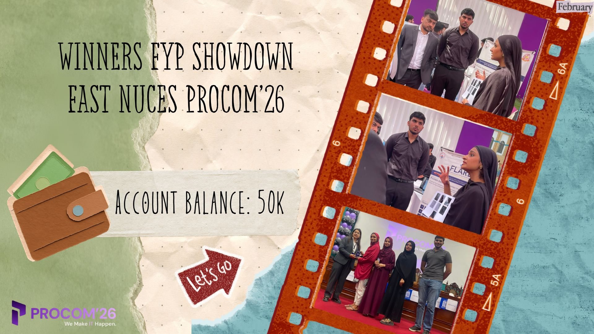
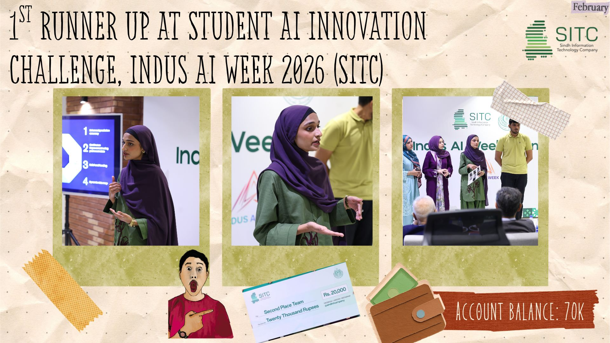
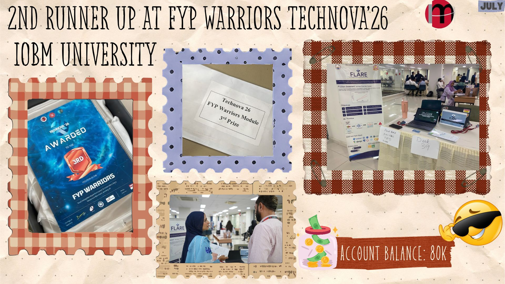
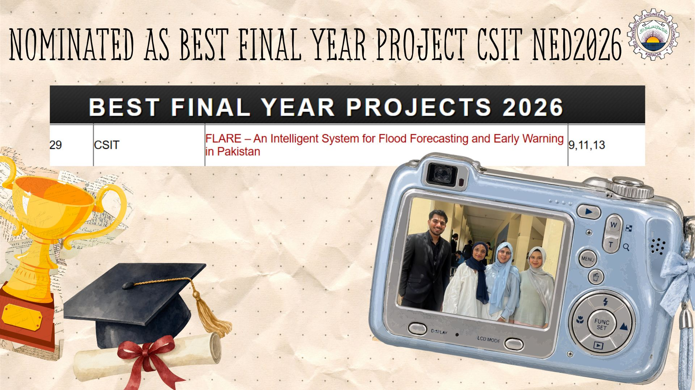
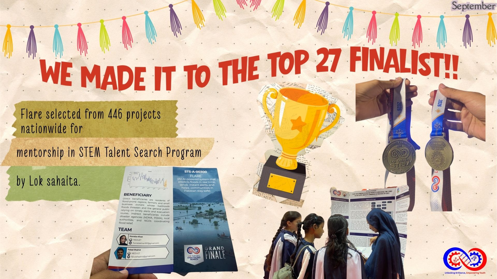

<h1 align="center">Hunaiza Khan</h1>

  <b>Most of my week goes to building ML systems. My weekends are spent at Ashrei Tech NASTP, teaching them.</b>
   
  Data Scientist and Machine Learning Engineer · Karachi, Pakistan

  
  

---

Hi, I'm Hunaiza Khan . On weekdays I'm an AI engineer at SIRP, where I build [SARA Open](https://sara-open.sirp.io/), a public AI security Co-Analyst. A lot of my job is teaching a model what it isn't allowed to say: the guardrails that keep it from arguing with the facts, so a confident model can't overrule a threat feed.

Come the weekend, I swap production logs for a whiteboard at NASTP, Pakistan's Silicon Valley. I'm there with 40 students who started with "what's a NumPy array?" and are now training neural nets. I also just wrapped up a stint as a section leader for Stanford's Probability for AI, which mostly meant convincing people that Bayes' rule is fun. It is.

The thing I'm proudest of is FLARE, a flood forecaster I built with my team for rivers that flood my own country almost every monsoon.

## FLARE

One LSTM covers 13 river gauges in the Jhelum and Indus basins and predicts a full range of outcomes for each of the next seven days. Sentinel-1 satellite radar then turns each forecast into a flood map. It averages R² 0.818 across stations (0.916 one day ahead), and the flood maps reach an F1 of up to 0.969. I led the team, built the dataset in Google Earth Engine, trained the forecaster, and did all the pitching.

<table>
  <tr>
    <td align="center" width="50%"> Winners, FYP Showdown · FAST NUCES PROCOM'26</td>
    <td align="center" width="50%"> 1st Runner-Up, Student AI Innovation Challenge · Indus AI Week 2026 (SITC)</td>
  </tr>
  <tr>
    <td align="center"> 2nd Runner-Up, FYP Warriors · Technova'26, IoBM</td>
    <td align="center"> Nominated, Best Final Year Project · CSIT, NED University 2026</td>
  </tr>
  <tr>
    <td colspan="2" align="center"> Top 27 of 446 projects nationwide · Lok Sahaita STEM Talent Search</td>
  </tr>
</table>

## Teaching

- Ashrei Tech (NASTP), AI and Data Science Trainer, Oct 2026 to present. I designed and teach my own ML and deep learning course (regression, classification, clustering, neural nets) to 40 students.
- Stanford University, Section Leader, Probability for AI, Oct 2026. I led weekly sections in a 6-week program on the probability behind modern AI models.
- NED University, Teaching Assistant, Jan to June 2026. I ran live OOP coding labs for 50 undergraduates.

## Research

- NED University, Research Assistant, Jan to June 2026. I built a visual RAG pipeline on CIFAR-100 with CLIP embeddings for text-to-image search and few-shot recognition.
- [A Survey on Machine Learning-Based IoT Device Classification and Fingerprinting](https://ieeexplore.ieee.org/abstract/document/11576468). H. Khan, F. Shahid, S. M. Awan. ICISCT 2026, IEEE Xplore.
- A Regional LSTM-CMAL Model for Probabilistic Flood Forecasting and SAR-Based Inundation Mapping. H. Khan, F. Shahid, S. M. Awan. ICONICS 2026, NED University, December 2026 (accepted).

## Featured projects

Every number below comes from a real run recorded in the repo. Each repo has tests, pinned dependencies, a FastAPI service where relevant, and an error-analysis section.

| Project | What it does | Result |
|---|---|---|
| [text-classification-nlp](https://github.com/HunaizaK/text-classification-nlp) | News topics: TF-IDF + SVM vs fine-tuned DistilBERT, then int8 quantization and distillation | 90.2% vs 88.0% (p = 0.0006); int8 model 268 → 139 MB, 1.7× batch throughput; distilled linear student 89.4% |
| [image-processing-classical-vs-deep](https://github.com/HunaizaK/image-processing-classical-vs-deep) | Traffic signs (GTSRB): OpenCV HOG + SVM vs a Keras CNN, with corruption-robustness tests | CNN 97.7% vs 94.5%; on rotated signs 64% vs 14.5%; classical model 0.66 MB at 1.1 ms/image |
| [customer-churn-ml](https://github.com/HunaizaK/customer-churn-ml) | Telecom churn: segmentation, 4-model comparison, cost-based decision threshold, SHAP explanations | ROC-AUC 0.845; tuned threshold catches 88% of churners at 10% lower expected cost |
| [deep-learning-architectures](https://github.com/HunaizaK/deep-learning-architectures) | Nine architectures implemented, trained and analysed: feed-forward, CNN (Keras + PyTorch), LSTM/GRU, transformer from scratch, VAE, DCGAN, SimCLR | CNN 90.5% on Fashion-MNIST; transformer from scratch 83.8% on IMDB; whole suite runs in 23 min on CPU |
| [ipcv](https://github.com/HunaizaK/ipcv) | Elderly-care monitoring: real-time action detection with an X3D-M 3D CNN, alert smoothing, caregiver email alerts, React dashboard | 78.9% on people never seen in training; 100% of falls and staggering caught |
| [Adaptive-E-learning-Platform](https://github.com/HunaizaK/Adaptive-E-learning-Platform) | RL tutor (DQN vs PPO) that sequences 73 Python lessons over an 18-concept prerequisite graph | Showed that the top-reward agent (DQN, 2.3× the fixed curriculum's reward) was gaming the reward: 19.4 prerequisite violations per session |

<table>
  <tr>
    <td align="center" width="33%">
      
       Contrast equalisation and HOG edges on a dark traffic sign
    </td>
    <td align="center" width="33%">
      
       DCGAN samples after 40 epochs
    </td>
    <td align="center" width="33%">
      
       SHAP explanations of what drives churn
    </td>
  </tr>
  <tr>
    <td colspan="3" align="center">
      
       Robustness test: CNN vs HOG + SVM accuracy as noise, blur, darkness, rotation and occlusion increase
    </td>
  </tr>
</table>

## Tech stack

ML and deep learning
 

NLP, vision and LLMs
 

Data
 

MLOps and backend
 

---

  Open to ML engineering conversations: <a href="https://www.linkedin.com/in/hunaiza-khan197/">LinkedIn</a> · <a href="mailto:hunaizakhan197@gmail.com">hunaizakhan197@gmail.com</a>

